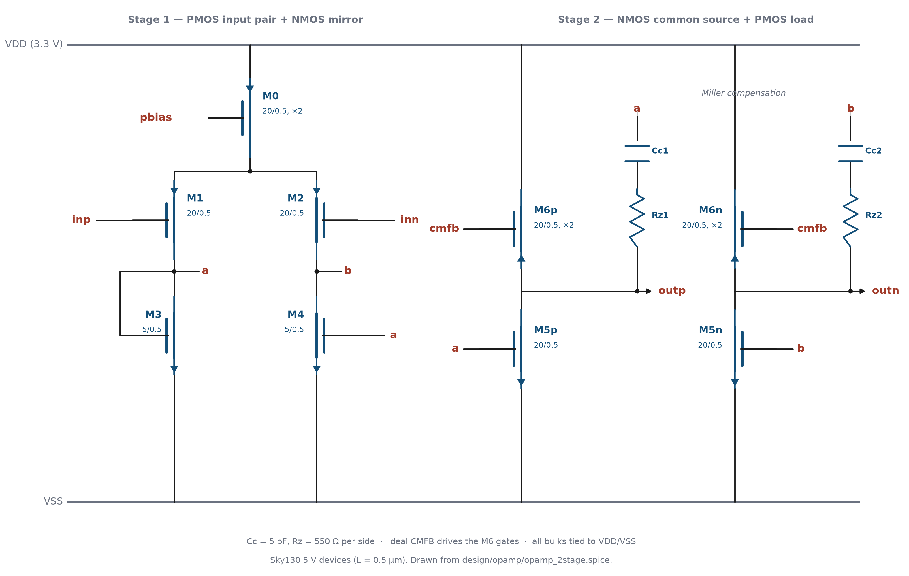
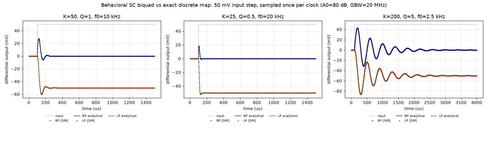

# sky130_ip_scbiquad — clock-programmable SC biquad (Chipalooza #4)

A fully differential, second-order switched-capacitor biquad in Sky130 with
simultaneous **low-pass** and **band-pass** outputs. This repository is a
**pre-layout feasibility prototype**: exact z-domain sizing, a behavioral
switched-capacitor model, op-amp requirement sweeps, and a transistor-level
two-stage op-amp proof-of-concept. The transistor-level biquad, full PVT and
layout are planned after acceptance.

## Design

- **f0 = fclk / K**, K ∈ {25, 50, 100, 200}; fclk 10 kHz–1 MHz
  (≤500 kHz at K = 25) → **f0 = 50 Hz–20 kHz**
- **Q** in 8 steps, 0.5–5 (√2-spaced), exact z-domain (LDI) design
- **Gain** 0 / 6 / 12 / 18 dB via the input-branch capacitor `Cs1 = G·Cs`
- **MiM capacitors only**: 33.6–68.7 pF at 0 dB, 37.2–117.6 pF at 18 dB;
  worst MiM area 0.0585 mm² (target ≤120 pF, ≤0.12 mm²; excludes switches,
  op-amps, bias and routing)
- VDDA 3.3 V, VDDD 1.8 V; 5 V Sky130 devices in the analog core
- **Built-in test**: internal square wave (fclk/64 … /4096) for f0/Q
  measurement with only a scope
- **Chip interface**: 4 shared analog lines, a dedicated CLK_IN pad,
  harness bias references, up to 24 control bits and 12 test outputs

The op-amp is a fully differential two-stage Miller design with an ideal
CMFB model in the prototype:



*Two-stage op-amp: PMOS input pair, NMOS mirror load, NMOS common-source
second stage, PMOS loads, 5 pF + 550 Ω Miller compensation per side. Drawn
from [`design/opamp/opamp_2stage.spice`](design/opamp/opamp_2stage.spice);
the xschem source is
[`design/opamp/opamp_2stage.sch`](design/opamp/opamp_2stage.sch).*

## Prototype status

| Check | Result |
|---|---|
| Capacitor budget `[ANALYTICAL]` | 33.6–68.7 pF at 0 dB, 37.2–117.6 pF at 18 dB; MiM area ≤0.0585 mm². Worst quantization: f0 +1.24 % (K=200/Q=5), Q +0.98 % |
| Behavioral biquad `[SIM]` | LP/BP step response matches the exact discrete map within **0.09 % of peak**; LP gain steps 0/6/12/18 dB with 0.060 dB worst error |
| Offset `[SIM]` | 5 mV op-amp offset → **29.4 mV** worst at 0 dB/Q≤2 and **45.5 mV** over all gain/Q (adopted limits 40/60 mV) |
| Op-amp requirement `[SIM]` | 18 dB gain needs A0 ≥60 dB and GBW ≥5 MHz; 0 dB alone needs A0 ≥49 dB and GBW ≥3 MHz |
| Transistor op-amp `[SIM]` | tt/ss/ff: **50.0/49.0/50.5 dB**, **10.6/7.82/13.94 MHz**. tt/ff meet 50 dB and 10 MHz; ss misses both, and all corners are below the 60 dB needed at 18 dB |
| Full PVT, Monte Carlo, THD, final noise, layout | planned post-acceptance |



*Behavioral switched-capacitor biquad (dots) against the exact discrete-time
map (lines) at K=50/Q=1, K=25/Q=0.5 and K=200/Q=5. Blue = band-pass,
red = low-pass.*

Full per-spec verdicts, including the adopted measurement-driven spec
adjustments, are in [`results/spec_check.md`](results/spec_check.md). The
headline conclusions are in [`results/summary.md`](results/summary.md).

## Reproduce

Prerequisites: Python ≥3.10 with `numpy` and `matplotlib`; `ngspice` for
simulation. A Sky130 PDK is needed only for the transistor-level op-amp and
for viewing the xschem schematic.

```bash
python3 -m pip install numpy matplotlib
make cap        # exact z-domain capacitor table
make behav      # behavioral sweeps, gain/offset/Q checks
make plots      # regenerate figures in results/plots/
```

```bash
export PDK_ROOT=/path/to/sky130A   # or its parent directory
make opamp                         # 3-corner Sky130 op-amp simulation
xschem design/opamp/opamp_2stage.sch
```

`make all` runs `cap`, `behav` and `opamp` (so it requires the PDK).
`make plots` also regenerates the schematic figure and needs no PDK. The
committed results and figures are already under `results/`; these commands
are only for regeneration.

## Repository layout

```
spec/    spec.md (single source of truth), corners.md
docs/    architecture.md, io_and_controls.md, test_plan.md, plan.md
sim/     capbudget.py, plots.py; behavioral/ (biquad model and sweeps)
design/  opamp/ (xschem schematic, netlist, AC/step testbenches)
results/ spec_check.md, summary.md, capbudget_table.md,
         behavioral/, opamp/, data/, plots/
```

## Known limitations

- **ss op-amp corner** misses the 50 dB / 10 MHz minimums; all three corners
  are below the 60 dB A0 required at 18 dB. At 49–50 dB the differential Q
  error at 18 dB is 5.0–6.3 % (inside the ±15 % max, outside the ±5 % typ);
  a targeted sweep gives 1.9 % at A0 = 60 dB.
- **K=200/Q=5** step-ring extraction suggests a Q error that the multisine
  cross-check does not confirm; treated as an extraction artifact pending
  transistor-level measurement.
- **IDDA** is 1.22 mA typ at 1 MHz (adopted 1.3 mA typ / 2.0 mA max); the ff
  corner is 1.43 mA. Output buffers, bias, CMFB and clock generation are
  excluded.
- **Noise** is a kT/C-only estimate (66.7 µVrms at 0 dB, 87.2 µVrms at
  18 dB); 1/f, op-amp, THD and clock-feedthrough terms are not included.
- No full 45-corner PVT, Monte Carlo mismatch, THD, clock-feedthrough,
  layout, DRC/LVS or pads yet.

## Documentation

- [`spec/spec.md`](spec/spec.md) — specification and adopted changes
- [`docs/architecture.md`](docs/architecture.md) — architecture and
  ideal-vs-transistor modeling assumptions
- [`docs/io_and_controls.md`](docs/io_and_controls.md) — pad and control plan
- [`results/spec_check.md`](results/spec_check.md) — per-spec verdict
- [`results/plots/README.md`](results/plots/README.md) — all figures and
  current snapshot values
- [`docs/plan.md`](docs/plan.md) — post-acceptance milestones and risks

## License

Apache-2.0 — see [`LICENSE`](LICENSE). SPDX headers appear on every script
and netlist.
