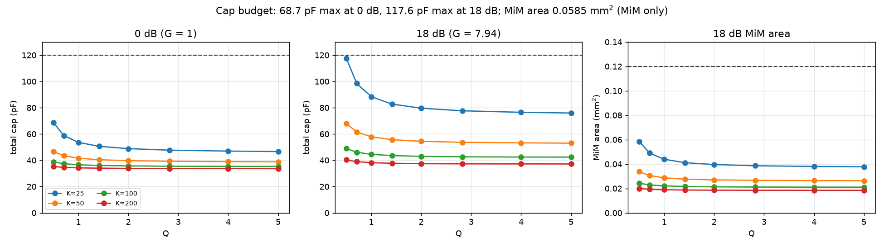
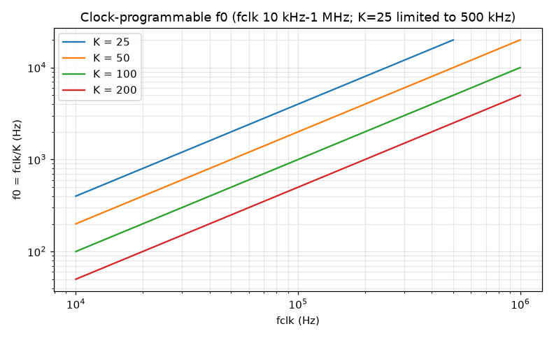
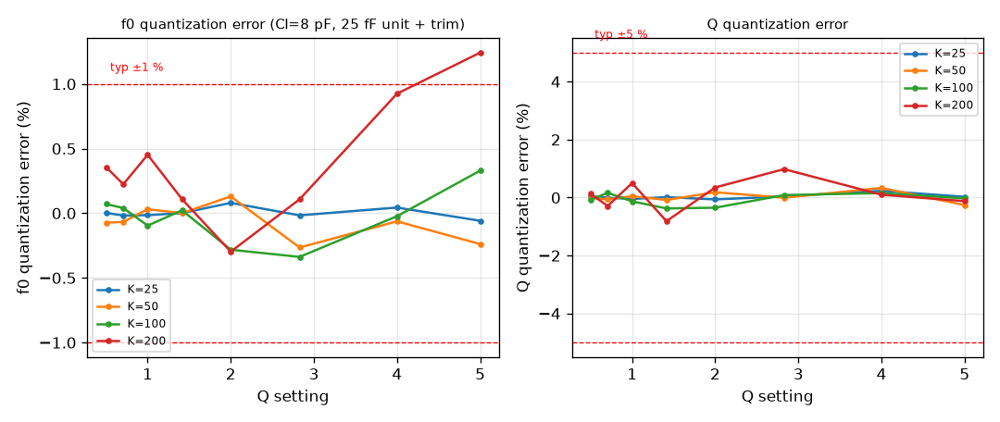
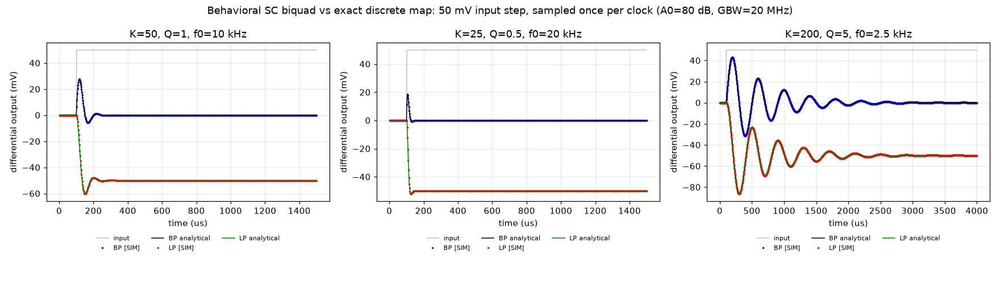
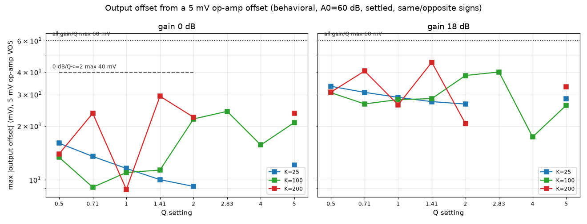
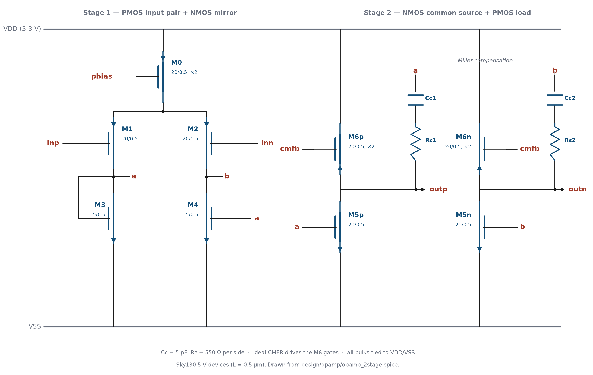
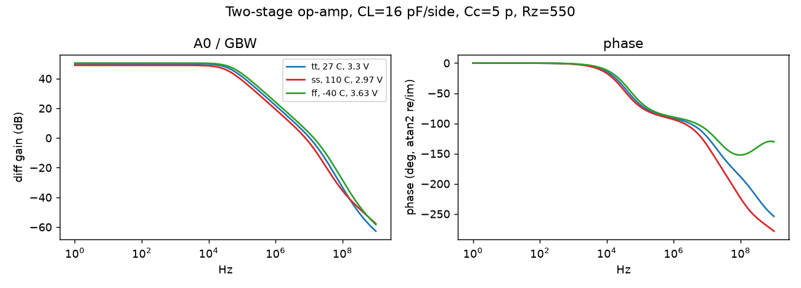

# Figure snapshots

Generated by `python3 sim/plots.py` (`make plots`). These PNGs are the committed visual evidence; the raw CSV and simulator data are regenerated by the make targets and are not committed.

| Figure | What it shows | Source |
|---|---|---|
| `fig_capbudget.png` | Total MiM capacitance at 0 and 18 dB and MiM area at 18 dB for all 32 (K,Q) settings. Dashed lines are the 120 pF target and 0.12 mm2 area spec. Counts both halves and all branches; switches, op-amps, bias and routing are excluded. | `sim/capbudget.py` (exact z-domain) |
| `fig_f0_vs_fclk.png` | Programmable f0 = fclk/K versus clock frequency; K=25 is limited to fclk <= 500 kHz. | architecture definition |
| `fig_q_vs_setting.png` | f0 and Q quantization error of the unit-cap-plus-trim design versus Q setting. The f0 panel marks the adopted +/-1 % (K<=100) and +/-1.5 % (K=200) typ limits; the Q panel marks +/-5 %. | `sim/capbudget.py` (exact z-domain) |
| `fig_step_response.png` | Sampled LP/BP step response of the behavioral SC biquad against the exact discrete map for K=50/Q=1, K=25/Q=0.5 and K=200/Q=5 (ideal switches, A0=80 dB, GBW=20 MHz). | `sim/behavioral/biquad_behav.spice` + `run_sweep.py` |
| `fig_offset_map.png` | Worst settled output offset versus Q for each K at 0 and 18 dB, with 5 mV op-amp input offset and both same-sign and opposite-sign combinations. Spec lines: 40 mV for 0 dB/Q<=2 and 60 mV for all gain/Q. | `run_sweep.py --mode offset` |
| `fig_opamp_schematic.png` | Two-stage fully differential op-amp topology with device sizes, Miller Cc/Rz networks and the ideal CMFB gate drive. Drawn from the committed netlist; all bulks tie to VDD/VSS. | `design/opamp/opamp_2stage.spice` |
| `fig_opamp_bode_tt_ss_ff.png` | Transistor-level op-amp differential gain and phase at tt/27 C/3.3 V, ss/110 C/2.97 V and ff/-40 C/3.63 V (CL=16 pF/side). Legend gives A0 and GBW from each run. | `design/opamp/tb_ac.spice` (Sky130 PDK) |

## Figures

### Cap budget at 0/18 dB and MiM area at 18 dB.

### Programmable f0 = fclk/K versus clock frequency.

### f0 and Q quantization error against the adopted typ limits.

### Behavioral step response versus the exact discrete map.

### Worst output offset versus Q at 0 and 18 dB.

### Two-stage fully differential op-amp topology.

### Transistor-level op-amp gain and phase at three corners.

## Snapshot values from this run

- **op-amp schematic**: two-stage fully differential topology drawn from design/opamp/opamp_2stage.spice.
- **cap budget**: 68.7 pF max at 0 dB, 117.6 pF max at 18 dB, 0.0585 mm2 MiM area at 18 dB.
- **quantization**: worst f0 +1.24 % at K=200/Q=5, worst Q +0.98 % at K=200/Q=2.828.
- **step response**: three settings compared with the exact discrete map; worst sampled point differs by 0.09 % of that output peak.
- **offset**: worst 29.4 mV at 0 dB/Q<=2, 45.5 mV over all gain/Q.
- **op-amp Bode**: tt: 50.0 dB / 10.60 MHz; ss_110C: 49.0 dB / 7.82 MHz; ff_m40C: 50.5 dB / 13.94 MHz.

Re-run with `make cap behav plots` for the full set. `make plots` alone regenerates the analytical figures, the schematic and the PDK-free step figure; the offset figure needs the generated offset CSV and the Bode figure needs the Sky130 PDK.
